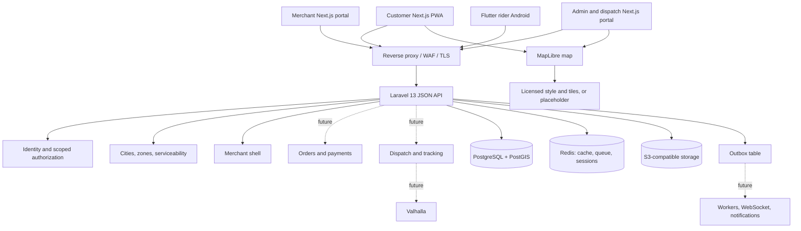

# Architecture diagram

Phase 1 view. Dotted edges are future integrations that do not exist yet. Source: spec section 2.

Decisions behind each box are in `decisions/`. Trust boundaries are in `docs/security/threat-model.md`.
